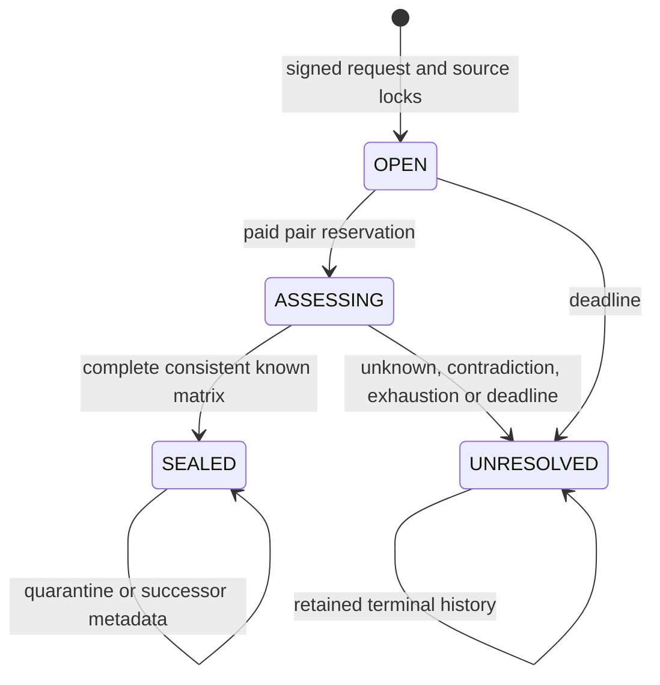

# Rhizome architecture

Rhizome certifies independence of evidence production, not the truth of an event. Validators retrieve committed public records, independently classify production ancestry under an immutable policy, and agree on the material relation and controlling rules. Applications decide what a certificate permits.

The registry owner approves authority principals and public retrieval channels. Principals attest immutable source revisions. Policy owners create immutable policy revisions. Anyone may open an owned batch. Its owner may fund and evaluate pairs or authorize sponsors for that request. Each paid reservation is committed before semantic execution, so a failed consensus execution still consumes one of three paid reservations. The payer or request owner can release a hold; the owner can revoke sponsorship. Protocol validator rotation remains outside application control.

A batch contains two through six locked sources. A pair packet contains the two source records and their two disclosed control records. Validators inspect complete bytes, authenticate every commitment and span, evaluate once, and compare normalized relation, origins, scope, control coverage and rule IDs. Witnesses use canonical complete-record spans. No free-form model prose enters authoritative state.

The deterministic sealer enumerates every subset, requires every chosen edge to be INDEPENDENT, selects the lexicographically first maximum subset and retains it. Shared edges form equivalence classes. An independent edge inside their transitive closure is a contradiction. Unknown edges across classes prevent a conclusive count even when a smaller independent clique exists. A terminal unresolved certificate reports zero certified origins and preserves the diagnostic subset separately. Partial matrices may terminate only as unresolved, with incomplete coverage visibly recorded.

Consumers verify policy thresholds and exact bindings against finalized source records before committing local state, then register them through authenticated messages. A secondary application can consent to reuse a certificate under its own consequence digest without adopting the primary application's verdict. Publication binds the source envelope, consumer's signed approval, generation and operation ID. Calls emit only on finalized status. Consumers authenticate the source contract, check current revision/quarantine metadata at action time, reject stale generations and retain operation acknowledgements. Ordinary views provide freshness information. Proof-backed views expose exact record commitments established by authenticated self messages emitted after their creating parents finalize; consumers use them before persisting configuration and bindings. Revision and generation confirmation indices advance monotonically, and identical tentative replays cannot emit new proofs. Tentative restrictions suppress permission but do not permanently mutate finalized consumer state. A delivery blocked only by tentative source state returns DEFERRED without acknowledgement and can be retried under its original operation ID.

New schema fields require append-only storage compatibility. This deployment has no upgrade entry point. Incompatible schemas require a new contract address and explicit consumer rebinding.
