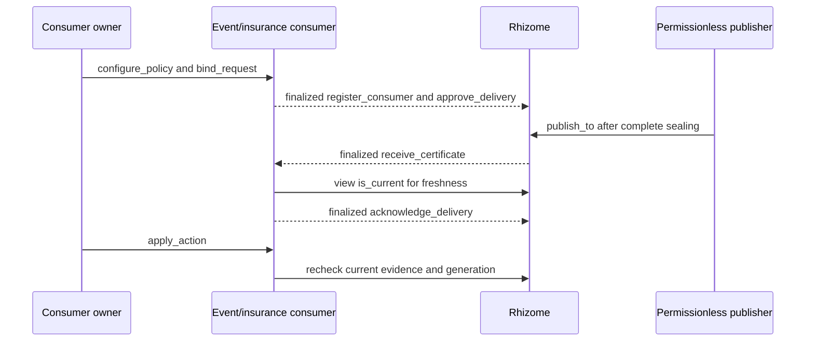

# Integrating Rhizome with two independent consumers

## Deployment and signing

Deploy `contracts/assessment_treasury.py` first, then deploy `contracts/rhizome.py` with that treasury contract address and a positive assessment charge in atto-units. The treasury must implement a payable `accept_fee()` method. Its deployer becomes registry owner. Deploy `contracts/event_resolver.py` and `contracts/insurance_gate.py` from separate consumer owner keys; each constructor accepts the Rhizome address. All four deployment receipts must show successful execution and finalization, and `gen_getContractCode` must decode to the exact pinned source bytes.

The Studio client in `scripts/studio.py` loads signing keys from an external JSON file named by `RHIZOME_CREDENTIALS_FILE`. The verification workflow uses `deployer_private_key`, `resolver_private_key`, `insurance_private_key`, `delta_private_key`, `epsilon_private_key` and `zeta_private_key`. The last three provide distinct principals for the six-source test. Keep the file outside the repository with owner-only permissions. A GitHub token is unrelated to contract execution and is never sent to Studio.

```bash
export RHIZOME_CREDENTIALS_FILE=/secure/rhizome-keys.json
export RHIZOME_RUN=treasury-v3
.venv/bin/python -m scripts.studio deploy
.venv/bin/python -m scripts.studio call \
  --address '<Rhizome address>' --method get_limits
```

The deploy command configures the verification deployment with a one-atto fee. For a production fee, call `Studio.submit` with your own constructor arguments and operation namespace, or use the GenLayer CLI against its configured network. Studio transactions are gasless, but a nonzero assessment charge still requires actual native value on the paying account.

## Source and policy preparation

1. The policy owner calls `register_policy` with the definition, exact scope and required count. The event policy requires three origins; the separate insurance policy requires two.
2. The registry owner calls `register_authority` for each disclosed publisher/control channel and signed principal. The principal calls `attest_source` for each immutable source revision.
3. The request owner builds the complete source/authority manifest and canonical envelope described in [protocol.md](protocol.md), then calls `open_batch`.
4. Before assessment, each participating consumer owner configures its immutable policy version and locks the returned batch plus its own intended consequence.

Records must be available through the configured public HTTPS channel, match every raw-byte commitment and span, and substantiate scope, control and production ancestry. URLs, candidate origin labels and matching conclusions are insufficient. The verification fixture uses a public HTTPS byte mirror for explicitly synthetic signed records; the mirror supplies retrieval, not publisher authority. Production integrators must choose their own disclosed authentic evidence and authority configuration.

## Event resolver

The `EventResolver` owner chooses an event verdict before semantic assessment. Rhizome gates evidence independence and does not supply that verdict. This adapter refuses resolution when coverage is unresolved, evidence is quarantined or superseded, or fewer than three origins are certified.

```python
from scripts.studio import Studio, canonical

studio = Studio()
batch = studio.read(rhizome_address, "get_batch", [request_id])
env = batch["envelope"]
binding = {**env, "batch_digest": batch["batch_digest"]}
consequence = {
    "subject_id": env["subject_id"],
    "action": "RESOLVED",
    "value": "the event verdict chosen by the consumer owner",
}

configured = studio.submit(
    "resolver-config-v1", resolver_address, "configure_policy",
    [env["policy_id"], env["policy_revision"], 3], role="resolver",
)
studio.drain(configured, "resolver-config-v1")
bound = studio.submit(
    "resolver-bind-001", resolver_address, "bind_request",
    [canonical(binding), canonical(consequence)], role="resolver",
)
studio.drain(bound, "resolver-bind-001")
```

`configure_policy` emits finalized `register_consumer` to Rhizome. `bind_request` emits finalized `approve_delivery`, committing the consumer's actual consequence separately from the source envelope's locked intended consequence. A secondary consumer can independently approve a different consequence for the same certificate. Both digests are carried and checked; one application's approval grants another application no authority.

For every unordered source pair, a payer submits the exact charge with `reserve_pair`, verifies its finalized execution and treasury transfer, then calls `assess_pair` under the same payer. The result must show independently agreeing validators; an accepted lifecycle alone is insufficient. After every pair has a supported decision, call `seal_batch`.

```python
reserved = studio.submit(
    "event-001-reserve-alpha-beta", rhizome_address, "reserve_pair",
    [request_id, "alpha", "beta", "event-001-alpha-beta"], value=assessment_fee,
)
studio.drain(reserved, "event-001-reserve-alpha-beta")
studio.submit(
    "event-001-assess-alpha-beta", rhizome_address, "assess_pair",
    [request_id, "alpha", "beta"],
)
# Assess every other pair before sealing a three-source or larger batch.
studio.submit("event-001-seal", rhizome_address, "seal_batch", [request_id])
published = studio.submit(
    "event-001-publish", rhizome_address, "publish_to",
    [request_id, resolver_address, "resolver-event-001"],
)
studio.drain(published, "event-001-publish")
ack = studio.read(rhizome_address, "get_delivery", [resolver_address, "resolver-event-001"])
assert ack["acknowledgement"]["outcome"] == "APPLIED"
studio.submit(
    "event-001-action", resolver_address, "apply_action",
    [env["subject_id"], "resolver-action-001"], role="resolver",
)
```

The action is a durable owner-selected resolution record, available through `get_action`. It executes once per subject generation. Integrators can use this same authenticated callback pattern to trigger another application-specific effect.

## Insurance gate

The insurance owner can consume the event certificate under its own policy threshold and consequence without adopting the event verdict. It can also open a distinct batch using a separately owned two-origin policy. Its terminal positive action is `UNDERWRITING_ENABLED`, and its unresolved consequence is `KEEP_RESTRICTED`.

```python
consequence = {
    "subject_id": env["subject_id"],
    "action": "UNDERWRITING_ENABLED",
    "value": "coverage tier chosen by the insurance owner",
}
configured = studio.submit(
    "insurance-config-v1", insurance_address, "configure_policy",
    [env["policy_id"], env["policy_revision"], insurance_minimum], role="insurance",
)
studio.drain(configured, "insurance-config-v1")
bound = studio.submit(
    "insurance-bind-001", insurance_address, "bind_request",
    [canonical(binding), canonical(consequence)], role="insurance",
)
studio.drain(bound, "insurance-bind-001")
# Perform complete pair assessment and sealing before this publication.
published = studio.submit(
    "insurance-publish-001", rhizome_address, "publish_to",
    [request_id, insurance_address, "insurance-certificate-001"],
)
studio.drain(published, "insurance-publish-001")
studio.submit(
    "insurance-action-001", insurance_address, "apply_action",
    [env["subject_id"], "insurance-action-001"], role="insurance",
)
```

A consumer minimum may strengthen the source policy but cannot weaken it. Consequently, insurance consuming a source policy requiring three must also require at least three; its separate two-origin policy can permit two. Principal value is never deposited into Rhizome by either application. The only native custody is the bounded assessment charge awaiting its finalized treasury emission.

## Delivery, freshness and recovery



The callback authenticates Rhizome's sender, verifies the certificate/delivery digests and exact local bindings, and records `APPLIED`, `REFUSED`, `STALE` or `QUARANTINED`. Rhizome authenticates the returning consumer acknowledgement. A view never establishes finality. A pending newer local binding immediately restricts the subject; an older callback cannot clear that restriction. Source revision changes and quarantine are checked again when an action is attempted.

`RHIZOME_RUN` selects a separate deployment and artifact directory. Retain the same value to resume a run; choose a new name for a fresh deployment. Omitting it resumes the original pre-correction run. The `treasury-v3` run contains the payable contract and explicit fee-receiver interface. The original artifacts retain the non-payable reservation failure, and `payable-v2` retains the failed empty-calldata transfer to the deployer account. Never reuse old operation IDs after changing source, signer, value or arguments.

Each consumer exposes `configure_policy(policy_id, revision, minimum_count)`, `bind_request(expected_binding, consequence)`, `receive_certificate(payload)`, `apply_action(subject_id, operation_id)`, `refresh_subject(subject_id)`, `get_subject(subject_id)`, `get_acknowledgement(operation_id)`, `get_action(operation_id)` and `list_history(offset, limit)`. Owner authority is required for configuration, binding and action; refresh is permissionless; callbacks require the exact source contract. All methods reject payment.

The Studio client journals `INTENT` before signing, `BROADCAST` when the transport acknowledges submission, `SUBMITTED` with the consensus ID and `FINALIZED` with the execution outcome and receipt file. An interrupted acknowledged broadcast is recovered from its Ethereum receipt. An unknown submission outcome requires nonce/history reconciliation and does not automatically resubmit. Reusing an operation with different arguments, source bytes, signer or value is refused.

RPC calls are paced at 4.5 seconds, below the hosted 1,000-request hourly limit. Explicit HTTP 429 and JSON-RPC `-32429` refusals retry the identical request at most three times. The client honors numeric or HTTP-date `Retry-After` with a one-second reset buffer, falling back to 60 seconds when the header is absent or malformed. Long waits are split into at most 60-second intervals. Refusal headers and the selected delay are journaled. A timeout during a write remains ambiguous and stops without automatic rebroadcast. If the bounded retries are exhausted, retain the journal and resume after the rate window resets. New live requests use seven-day deadlines; saved request inputs remain immutable.

`wait_for_finality=False` returns a broadcast ID for independent operation cohorts. Call `Studio.wait` and verify every receipt before dependent operations. The verifier uses cohorts of at most fifteen, below the hosted pending cap. `Studio.drain` recursively checks emitted child transactions. Neither a journaled broadcast nor an incomplete callback chain counts as a completed application action.

Successful finalized batch and pair returns can be decoded with `finalized_result(receipt)` without an additional state read. The decoder requires finalized, agreed execution and refuses accepted, consensus-refused or execution-failed receipts. `ProtocolFailure` carries the finalized receipt when the network reports a consensus refusal. A temporary `UNDETERMINED` observation is saved and polling continues for the same transaction within the existing polling bound. A canceled transaction stops; no new assessment is automatically submitted. The live driver uses these committed returns and then validates every persisted pair through the sealed matrix. Saved finalized receipts are reused only after checking their transaction ID, lifecycle and execution outcome.

These returned bindings and decisions are historical snapshots. Query `is_current` when freshness matters; the consumers perform that check again at action time.

Repeat identical publication operations to recover a failed callback while evidence remains current. Conflicting operation reuse is refused. After finalized consensus refusal or an agreed execution failure, inspect `get_pair` and release its held reservation under the payer before a new paid application attempt. The failed attempt still consumes its reservation and fee. Retain the refused receipt and finalized release for audit. After three consumed attempts, a supported exhaustion condition permits `resolve_unavailable`; otherwise expiry or evidence invalidation supplies unresolved recovery. No caller controls protocol finality or validator rotation.

## Running the executable integrations

```bash
RHIZOME_CREDENTIALS_FILE=/secure/rhizome-keys.json RHIZOME_RUN=treasury-v3 \
  .venv/bin/python -m pytest tests/integration/test_studio.py tests/integration/test_source_changes.py -v -s -x --rhizome-resume
```

The suite deploys the actual primitive and adapters, uses distinct owner/principal keys, checks permitted/refused actions for both applications, executes a complete six-source matrix and verifies duplicate/reordered/forged callbacks, source revision invalidation, quarantine and retry exhaustion. Its public records are labelled synthetic; no web, model, contract or callback is mocked. Replay inputs and finalized parent/child receipts are preserved under `verification/<RHIZOME_RUN>`.

The final revision tests intentionally invalidate earlier certificates. Resume an interrupted run from its recorded operation IDs and last completed scenario; replaying positive action tests after their sources have been superseded is expected to fail freshness checks. Use a new deployment and operation namespace for an entirely fresh run. Per-test logs and receipts describe what actually completed.

`--rhizome-resume` retains previously passing scenarios from this run and executes the unfinished scenarios. Omit it to rerun every scenario. The complete gate still requires all eleven scenarios, and the durable outcome history retains earlier failures. The local journal is Git-ignored; the verification report exports public signer addresses, exact operation inputs and transaction IDs to `operation-inputs.json` so published evidence remains independently inspectable.

## Assessment treasury

Rhizome emits `accept_fee()` with the exact assessment charge on finalized status. Its treasury address is immutable. The supplied treasury has no privilege over policies, source attestations, certificates or consumer principal. Its deployer owns only the fee account. `get_totals()` returns `owner`, cumulative `received_atto`, and actual `balance_atto`; the received counter excludes returned failed payouts.

`payout(operation_id, recipient_address, amount_atto)` requires the treasury owner, no attached value, a nonzero distinct receiver address, a positive integer amount below `2**256`, and sufficient current balance. The recipient must implement payable `accept_fee()`. Repeating identical arguments returns the same record without another emission; conflicting operation reuse fails. `get_payout(operation_id)` returns that record or null. A payout record has status `EMITTED_ON_FINALIZED`; only its successful finalized child receipt establishes recipient payment. Failed child executions are handled by the SDK's inherited refund handler. Inspect the refund and balance before a new payout operation.

```python
totals = studio.read(treasury_address, "get_totals")
payout = studio.submit(
    "treasury-payment-001", treasury_address, "payout",
    ["payment-001", compatible_receiver_address, 1],
)
studio.drain(payout, "treasury-payment-001")
```

Hosted Studio dispatched the pinned SDK's empty-calldata EOA transfer as a contract call; missing-contract execution errors led to finalized `NO_MAJORITY`. The explicit payable receiver removes that dependency. Deployment verification checks the receiver's source and receipt just as it checks the primitive and consumers.
